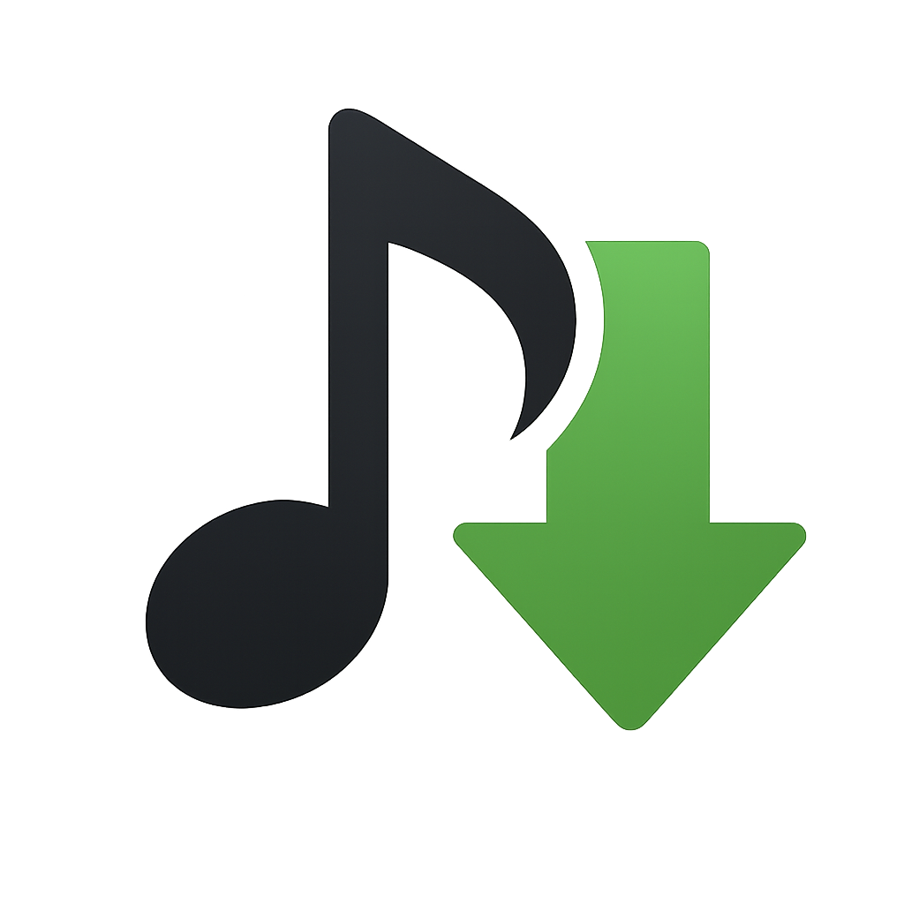
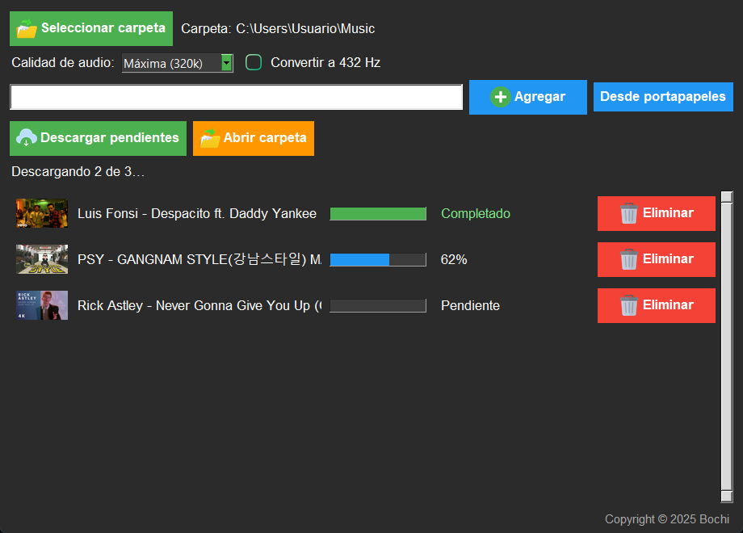

<p align="center">
  
</p>

<h1 align="center">Videos MP3 Downloader</h1>

<p align="center">
  Descarga el audio de YouTube en MP3, elige la calidad y conviértelo opcionalmente a 432 Hz.
</p>

<p align="center">
  
  
  
  
</p>

<p align="center">
  <a href="https://github.com/adrianllorian/DescargaMusicaYouTube/releases/latest/download/Videos.MP3.Downloader.exe">
    
  </a>
</p>

<p align="center">
  <strong>Windows 10/11 · 64 bits · 95 MB · sin instalación · se actualiza solo</strong>
</p>

---

## Vista previa

<p align="center">
  
</p>

## Características

- Descarga audio de YouTube en **MP3** con calidad de **64 a 320 kbps**.
- Conversión opcional a **432 Hz** manteniendo la duración.
- Lista de descargas con progreso, estado y cancelación.
- Descargas secuenciales para evitar saturar la conexión.
- Interfaz oscura en español, con miniaturas y detalles de error.
- **FFmpeg integrado** en el ejecutable: no requiere instalación aparte.
- Compatible con enlaces de YouTube, Shorts, `youtu.be` y YouTube Music.
- **Motor de descarga actualizable**: `yt-dlp` y Deno viven en la carpeta
  `tools`, junto al programa, y se actualizan solos sin recompilar ni volver a
  descargar la aplicación.
- **Aviso de versión nueva** dentro de la app, con botón **Actualizar**.

## Descarga

Descarga siempre la última versión desde este enlace fijo:

**[Videos MP3 Downloader (última versión)](https://github.com/adrianllorian/DescargaMusicaYouTube/releases/latest/download/Videos.MP3.Downloader.exe)**

- Archivo: `Videos.MP3.Downloader.exe`
- Tamaño: unos 95 MB
- Sistema: Windows 10/11 de 64 bits
- No necesita instalador: se ejecuta directamente.

> Windows SmartScreen puede mostrar un aviso porque el ejecutable no está firmado digitalmente. Pulsa **Más información → Ejecutar de todas formas**.

### Primera ejecución

La primera vez, la app crea una carpeta `tools` junto al ejecutable y descarga
automáticamente `yt-dlp.exe` y Deno (unos 65 MB en total). A partir de ahí:

- `yt-dlp` se comprueba y actualiza solo al abrir la app (caché de 12 horas).
- Si hay una versión nueva de la aplicación, aparece un aviso con el botón
  **Actualizar**. La app descarga el `.exe` nuevo, lo verifica con SHA-256, lo
  sustituye al cerrarse y se reinicia.
- No hay que volver a instalar ni descargar nada a mano.

### Verificar la descarga

En cada Release se publica `SHA256SUMS.txt` con el hash del ejecutable. Puedes
compararlo en PowerShell con:

```powershell
Get-FileHash ".\Videos.MP3.Downloader.exe" -Algorithm SHA256
```

## Uso

1. Abre **Videos MP3 Downloader**.
2. Selecciona la carpeta de destino.
3. Escribe o pega un enlace de YouTube y pulsa **Agregar**.
4. Elige la calidad y, si quieres, activa **Convertir a 432 Hz**.
5. Pulsa **Descargar pendientes**.

Las descargas se hacen de una en una. Puedes cancelar una descarga con **Eliminar** y consultar el motivo de un error pulsando sobre el estado en rojo.

## Ejecutar desde el código fuente

Requisitos:

- Python 3.10 o superior.
- FFmpeg (ver la sección siguiente).
- Dependencias de Python:

```powershell
python -m pip install -r requirements.txt
python gui.py
```

Al arrancar desde el código, la app también crea `tools/` y descarga `yt-dlp` y
Deno si faltan. La actualización automática del propio `.exe` solo se aplica al
ejecutable compilado; desde el código, el botón abre la página de Releases.

## Actualizaciones automáticas

El proyecto tiene tres capas independientes:

1. **Motor de descarga (`yt-dlp`)**: se descarga de su Release oficial, se
   verifica con SHA-256 y se sustituye en `tools/`. Cuando YouTube cambia algo,
   basta con reabrir la app.
2. **Deno**: se descarga automáticamente la primera vez y se usa para resolver
   los retos JavaScript de YouTube.
3. **Aplicación completa**: GitHub Actions compila y publica una Release nueva
   cuando cambia el código o cuando hay una versión nueva de `yt-dlp`. La app
   consulta `releases/latest` y avisa con el botón **Actualizar**.

El workflow está en [`.github/workflows/build-release.yml`](.github/workflows/build-release.yml)
y se ejecuta:

- al subir cambios a `main`,
- todos los lunes a las 06:00 UTC,
- manualmente desde la pestaña **Actions**.

No hace falta compilar ni subir el ejecutable a mano.

## FFmpeg: enlaces y ubicación

El ejecutable ya incluye FFmpeg. Esta sección solo es necesaria para ejecutar
desde el código fuente. El repositorio **no incluye FFmpeg** porque sus binarios
superan los 180 MB.

### Descargas

- Página oficial de FFmpeg:  
  https://ffmpeg.org/download.html
- Builds para Windows de Gyan (recomendado):  
  https://www.gyan.dev/ffmpeg/builds/
- Descarga directa, versión essentials (ZIP):  
  https://www.gyan.dev/ffmpeg/builds/ffmpeg-release-essentials.zip
- Descarga directa, versión full (7z):  
  https://www.gyan.dev/ffmpeg/builds/ffmpeg-release-full.7z
- Alternativa, builds de BtbN en GitHub:  
  https://github.com/BtbN/FFmpeg-Builds/releases

> **Essentials** es la opción más ligera. **Full** incluye más filtros, entre ellos `rubberband`, que mejora la conversión a 432 Hz. Si falta `rubberband`, la aplicación usa un método alternativo y sigue funcionando.

### Dónde colocarlo

1. Descarga y descomprime el ZIP o 7z.
2. Dentro habrá una carpeta similar a `ffmpeg-8.0-essentials_build\bin`.
3. Copia `ffmpeg.exe` dentro de `ffmpeg\bin\` del proyecto.
4. Recomendado: copia también `ffprobe.exe` en la misma carpeta.
5. No necesitas `ffplay.exe`.

La ruta final debe quedar así:

```text
Descarga de youtube\
└── ffmpeg\
    └── bin\
        ├── ffmpeg.exe
        └── ffprobe.exe
```

Comprueba que funciona:

```powershell
.\ffmpeg\bin\ffmpeg.exe -version
```

Si FFmpeg no está en esa ruta, la aplicación mostrará un aviso y no podrá descargar ni convertir el audio.

## Compilar el ejecutable

1. Instala Python 3.10 o superior y marca **Add Python to PATH**.
2. Coloca FFmpeg en `ffmpeg\bin\ffmpeg.exe`.
3. Ejecuta `compilar.bat` con doble clic.

También puedes compilar manualmente:

```powershell
python -m pip install --upgrade -r requirements.txt
python -m PyInstaller gui.spec --noconfirm
```

El resultado queda en:

```text
dist\Videos MP3 Downloader.exe
```

Notas:

- Cierra el programa antes de volver a compilar.
- La primera compilación tarda varios minutos.
- El `.exe` generado incluye FFmpeg, los iconos y las licencias.
- `yt-dlp` y Deno **no** se empaquetan: se descargan en `tools/` al ejecutar.
- La versión se define en `version.py`. El workflow la incrementa sola al
  publicar; no hace falta cambiarla a mano.

## Estructura del proyecto

```text
Descarga de youtube\
├── gui.py                 Interfaz gráfica
├── funciones.py           Descarga con yt-dlp y conversión a 432 Hz
├── actualizador.py        Actualización de yt-dlp, Deno y la app
├── config.py              Rutas y constantes
├── version.py             Versión de la aplicación
├── gui.spec               Configuración de PyInstaller
├── compilar.bat           Compilación local
├── requirements.txt
├── README.md
├── LICENSE
├── .github\
│   └── workflows\
│       └── build-release.yml
├── iconos\
├── licenses\
├── docs\
│   └── screenshot.png
├── tools\                 yt-dlp.exe y deno.exe (se crean solos)
└── ffmpeg\bin\ffmpeg.exe  (no incluido en el repositorio)
```

## Tecnologías

- Python + Tkinter
- yt-dlp (externo y actualizable)
- Deno (para los retos de YouTube)
- FFmpeg
- Pillow
- GitHub Actions

## Aviso legal

Este software es solo para uso personal y educativo. No está afiliado con YouTube ni con sus propietarios. Descarga únicamente contenido que tengas derecho a usar (propio o con licencia). El autor no se hace responsable del uso que se haga del programa.

Iconos de Flaticon: sonnycandra, Pixel perfect, Freepik y customicondesign_1.

## Licencia

Distribuido bajo **Apache License 2.0**. Consulta [LICENSE](LICENSE) y la carpeta [`licenses`](licenses).

---

<p align="center">
  Copyright © 2025 Bochi
</p>
